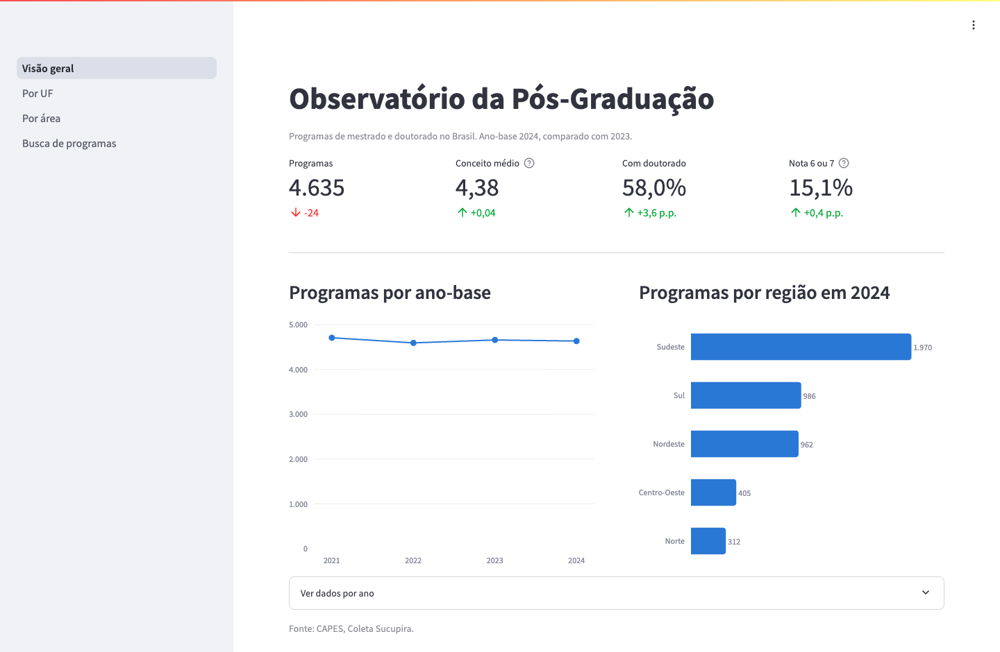
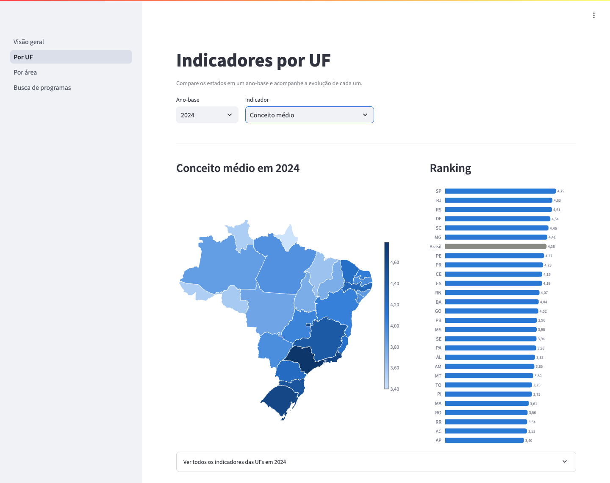
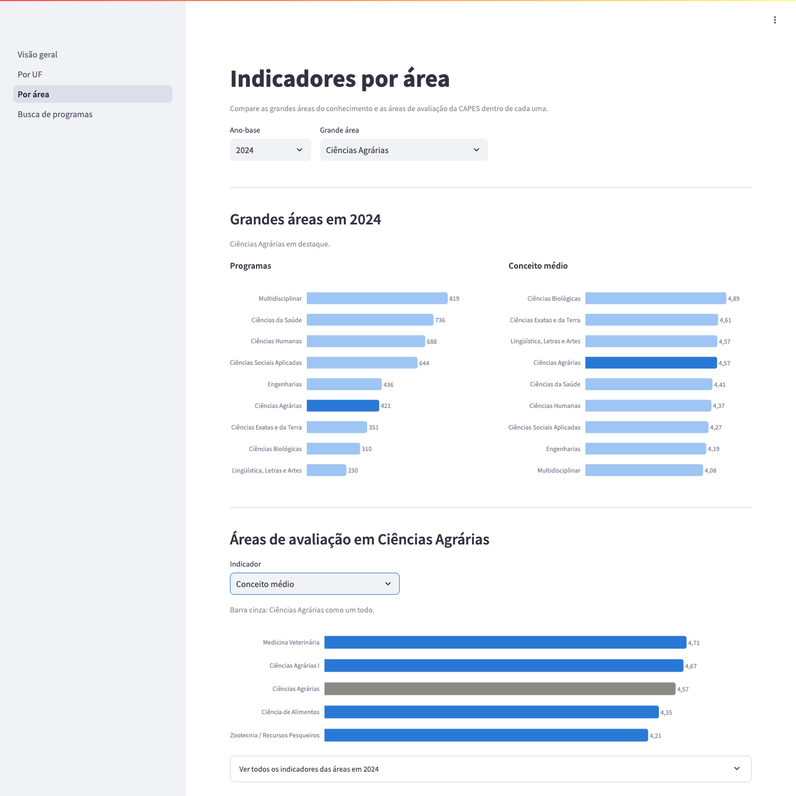
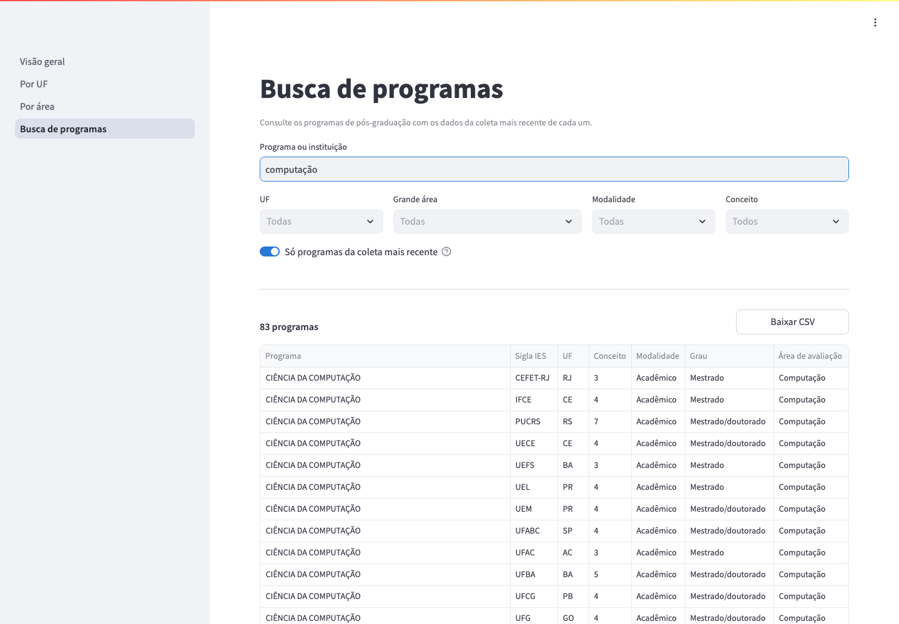

# Observatório da Pós-Graduação Brasileira

Pipeline de dados de ponta a ponta sobre os dados abertos da CAPES (Plataforma Sucupira): ingestão orquestrada com **Apache Airflow**, armazenamento em **PostgreSQL** com arquitetura medalhão (bronze → prata → ouro), transformação e testes de qualidade com **dbt** e painel interativo em **Streamlit**. Tudo sobe com Docker e usa apenas ferramentas open source.

## Arquitetura

```
 Portal de Dados Abertos CAPES (API CKAN)
              │
              ▼
 ┌──────────────────────── Airflow ────────────────────────┐
 │                                                         │
 │  ingest_capes_programas            transform_dbt        │
 │  ─────────────────────             ─────────────        │
 │  descobrir_recursos                dbt_deps             │
 │    └─► baixar_csv (1 por ano)        └─► dbt_build      │
 │          └─► carregar_bronze               ▲            │
 │                └─► validar_bronze ─────────┘            │
 │                       (Dataset)                         │
 └─────────┬──────────────────────────────────┬────────────┘
           ▼                                  ▼
       data/raw/              PostgreSQL (observatorio)
                          bronze ─► prata ─► ouro
                                              │
                                              ▼
                                  Streamlit (painel, :8501)
```

A DAG de ingestão roda semanalmente. Quando ela termina com sucesso, publica o Dataset da tabela bronze, e isso dispara a `transform_dbt`, que reconstrói a prata e a ouro e roda os testes. O painel lê só a camada ouro.

## Camadas

| Camada | Schema | Conteúdo | Quem escreve |
|---|---|---|---|
| Bronze | `bronze` | CSVs da CAPES como vieram, tudo em texto, com colunas de linhagem | Airflow |
| Prata | `prata` | `stg_capes__programas`: dado tipado, com nomes legíveis e uma linha por programa por ano-base | dbt |
| Ouro | `ouro` | `dim_programas`, `fct_programas_por_uf_ano` e `fct_programas_por_area_ano`, prontas para o painel | dbt |

As tabelas de fatos têm as mesmas métricas: total de programas, em funcionamento, acadêmicos, profissionais, com doutorado, conceito médio e programas nota 6 ou 7 (quantidade e percentual).

## Estrutura

```
observatorio-pos-graduacao/
├── dags/
│   ├── ingest_capes_programas.py   # DAG de ingestão
│   ├── transform_dbt.py            # DAG que roda o dbt
│   ├── datasets.py                 # Dataset que liga as duas DAGs
│   └── capes_utils.py              # funções puras (testadas)
├── dbt/
│   ├── models/staging/             # bronze → prata
│   ├── models/marts/               # prata → ouro
│   ├── macros/                     # métricas compartilhadas e nome dos schemas
│   ├── tests/                      # testes singulares
│   └── profiles.yml                # conexão via variáveis de ambiente
├── streamlit/
│   ├── app.py                      # navegação entre as páginas
│   ├── paginas/                    # visão geral, por UF, por área e busca
│   ├── db.py                       # conexão e consultas em cache
│   ├── indicadores.py              # agregação dos indicadores
│   ├── graficos.py                 # estilo dos gráficos e formatação
│   ├── dados/ufs.geojson           # malha das UFs (IBGE)
│   └── Dockerfile
├── sql/init/                       # cria banco do Airflow e schemas bronze/prata/ouro
├── tests/                          # testes com pytest
├── docs/img/                       # capturas de tela do painel
├── Dockerfile                      # Airflow + dbt
├── docker-compose.yml
├── .env.example
└── requirements-dev.txt
```

## Como rodar

Pré-requisitos: Docker e Docker Compose.

```bash
cp .env.example .env
# Linux: coloque o resultado de `id -u` em AIRFLOW_UID no .env
mkdir -p data logs
docker compose up -d --build
```

1. Acesse http://localhost:8080 (usuário e senha: `admin` / `admin`).
2. Ative as DAGs **`ingest_capes_programas`** e **`transform_dbt`**.
3. Dispare a ingestão com ▶ *Trigger DAG*. Quando ela terminar, a `transform_dbt` começa sozinha.
4. Confira o resultado:

```bash
docker compose exec postgres psql -U obs -d observatorio \
  -c "SELECT ano_base, uf, total_programas, conceito_medio FROM ouro.fct_programas_por_uf_ano ORDER BY 1 DESC, 3 DESC LIMIT 5;"
```

5. Depois que a `transform_dbt` terminar, abra o painel em http://localhost:8501.

O Postgres fica exposto no host na porta **5434**, para não conflitar com outros bancos locais.

| Serviço | Endereço |
|---|---|
| Painel (Streamlit) | http://localhost:8501 |
| Airflow | http://localhost:8080 |
| PostgreSQL | `localhost:5434` |

## Painel

O painel tem quatro páginas. Todas usam a coleta mais recente por padrão e os números seguem o padrão brasileiro (4.635 / 4,38).

**Visão geral:** números do último ano-base com a variação em relação ao anterior (programas, conceito médio, % com doutorado e % com nota 6 ou 7), evolução do total de programas e distribuição por região.



**Por UF:** mapa do Brasil colorido pelo indicador escolhido, ranking dos estados com o Brasil como referência, tabela com todos os indicadores e evolução de uma UF ao longo dos anos.



**Por área:** comparação entre as grandes áreas do conhecimento, ranking das áreas de avaliação dentro da grande área escolhida e evolução de cada área.



**Busca de programas:** busca por nome do programa ou da instituição (sem diferenciar acentos e maiúsculas), filtros por UF, grande área, modalidade e conceito, e exportação do resultado em CSV.



O código do painel fica montado no container, então ele recarrega ao salvar um arquivo. Se uma mudança não aparecer, reinicie o serviço com `docker compose restart streamlit`.

## Transformação com dbt

No dia a dia o dbt roda pelo Airflow. Para desenvolver os modelos, dá para rodar no host com o compose no ar:

```bash
python3.13 -m venv .venv
.venv/bin/pip install -r dbt/requirements.txt
cd dbt
../.venv/bin/dbt deps --profiles-dir .
../.venv/bin/dbt build --profiles-dir .
```

A conexão usa `localhost:5434` e o usuário do `.env` por padrão. Dá para trocar com `DBT_HOST`, `DBT_PORT`, `POSTGRES_USER` e `POSTGRES_PASSWORD`.

### Documentação dos modelos

Todos os modelos e colunas estão descritos nos arquivos `.yml`. Para ver a documentação com o grafo de linhagem:

```bash
cd dbt
../.venv/bin/dbt docs generate --profiles-dir .
../.venv/bin/dbt docs serve --profiles-dir . --port 8081
```

E abra http://localhost:8081.

### Testes de qualidade

O `dbt build` roda 26 testes junto com os modelos. Se algum falhar, a `transform_dbt` falha e os modelos seguintes não são atualizados.

- **Prata:** chave única por programa e ano-base, campos obrigatórios, valores aceitos para UF, região, modalidade, grau e situação, e conceito entre 1 e 7.
- **Ouro:** chave única em cada tabela e métricas dentro da faixa esperada.
- **`assert_ouro_total_igual_prata`:** a soma de programas por ano nas tabelas agregadas tem que bater com a prata.

## Testes das funções Python

```bash
pip install pandas pytest
pytest tests/
```

## Decisões técnicas

- **Descoberta via API CKAN:** a DAG lista os CSVs do dataset em vez de ter URLs fixas, então anos novos publicados pela CAPES entram sem mudar código.
- **Dynamic Task Mapping:** um download por arquivo, em paralelo e com retentativas independentes.
- **Bronze como texto:** todas as colunas entram como `text`, preservando o dado bruto; tipagem e limpeza ficam para a camada prata (dbt).
- **Colunas de linhagem:** `_arquivo_origem` e `_carregado_em` permitem rastrear cada linha até a fonte.
- **Validação após a carga:** a DAG falha se a contagem no banco divergir do que foi lido.
- **Conceito "A":** cursos novos aprovados ainda sem nota vêm com conceito `A`. Na prata eles ficam com `conceito` nulo e `sem_avaliacao = true`, e não entram no conceito médio.
- **Início dos cursos em texto:** `an_inicio_curso` vem como `2014/2019` (mestrado/doutorado), mas a ordem está invertida em parte dos registros. Por isso fica em texto, em vez de ser separado com uma regra que estaria errada nesses casos.
- **Áreas renomeadas:** algumas áreas de avaliação mudaram de nome entre os anos (ex.: Ciência da Computação para Computação). Os agregados usam o código da área e o nome mais recente, para a série histórica não quebrar.
- **Prata como tabela, não view:** a ingestão recria a bronze a cada carga, e o Postgres não deixa dropar uma tabela com views dependentes.
- **Dataset em vez de horário fixo:** a `transform_dbt` roda logo depois de cada ingestão bem-sucedida, sem depender de acertar horários entre as DAGs.
- **dbt num venv separado na imagem:** evita conflito de dependências com o Airflow.

### Painel

- **Só a camada ouro:** a regra de negócio fica no dbt e o painel só apresenta. A única conta feita no painel é reagregar os indicadores (em `indicadores.py`).
- **Médias ponderadas:** ao juntar UFs ou áreas, o conceito médio é ponderado pelos programas avaliados. Isso dá o mesmo resultado que a média sobre todos os programas da prata.
- **Referência só quando comparável:** o ranking e a evolução mostram o Brasil (ou a grande área) como referência para médias e percentuais, mas não para o total de programas, porque a soma do país não se compara com a de um estado.
- **Malha das UFs versionada:** o GeoJSON do IBGE fica no repositório, então o painel não depende da API do IBGE para abrir. Os polígonos foram reorientados para a convenção que o Plotly espera.
- **Busca em memória:** a `dim_programas` tem cerca de 4,8 mil linhas. Ela é lida uma vez, fica em cache por 10 minutos e é filtrada com pandas.
- **Nomes da CAPES:** grandes áreas e áreas de avaliação vêm em caixa alta e são formatadas para leitura. Nomes de programas e instituições ficam como a CAPES publica, porque têm muitas siglas.
- **CSV para o Excel em português:** a exportação usa `;` como separador e BOM UTF-8, para os acentos aparecerem certos.

## Roadmap

- [x] Etapa 1 — Ingestão dos programas de pós-graduação na camada bronze
- [x] Etapa 2 — Modelos dbt (prata e ouro) com testes de qualidade
- [x] Etapa 3 — Painel em Streamlit com indicadores por UF, área e ano
- [ ] Etapa 4 — Novas fontes (discentes, teses e dissertações) e busca semântica com embeddings
- [ ] Etapa 5 — CI com GitHub Actions e MinIO como data lake

## Fonte dos dados

[Portal de Dados Abertos da CAPES](https://dadosabertos.capes.gov.br/) — Coleta de Dados da Plataforma Sucupira, licença aberta.
